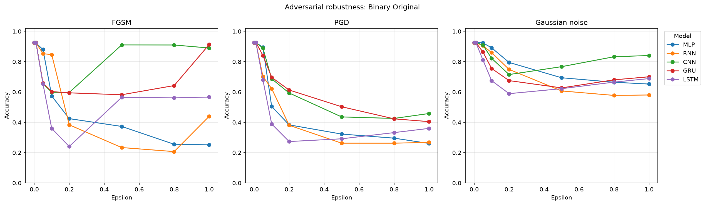
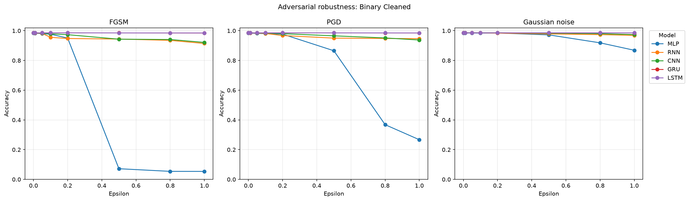
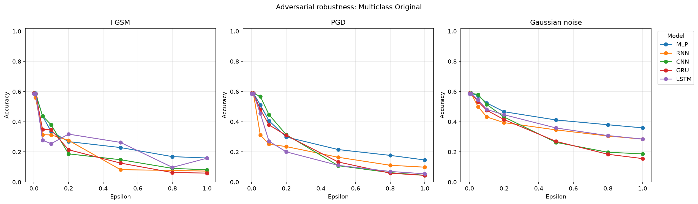
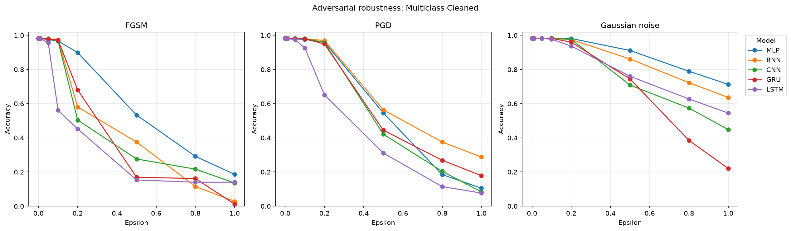
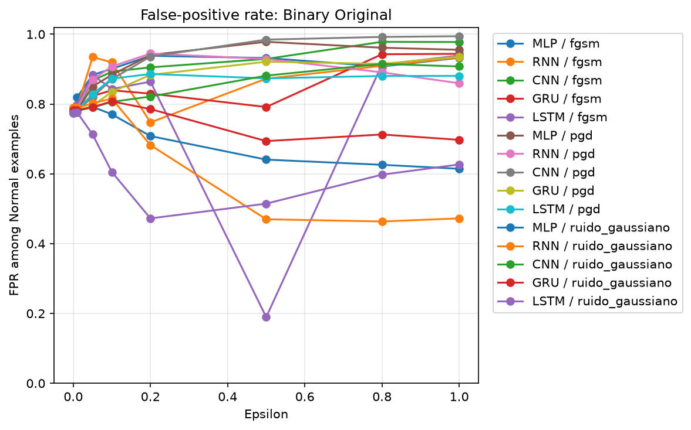
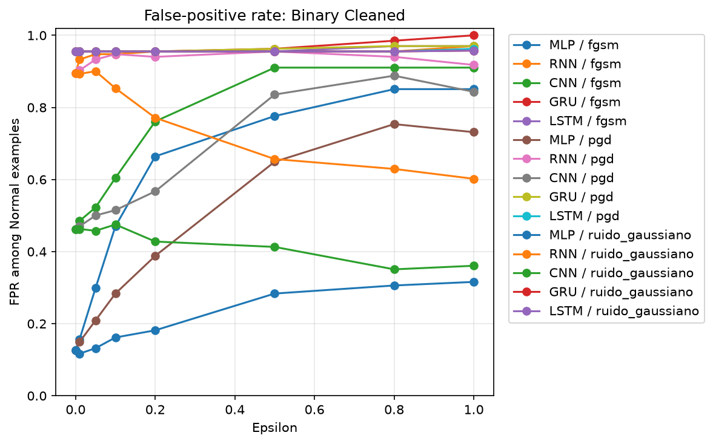

# Deep Learning Model Robustness to Adversarial Attacks

[](https://www.python.org/)
[](https://pytorch.org/)
[](https://scikit-learn.org/)
[](https://www.icmc.usp.br/)

This project evaluates how adversarial perturbations affect deep learning models used to classify network traffic associated with attacks against Unmanned Aerial Vehicles (UAVs / drones). Gradient-based attacks and random noise are tested on binary and multiclass tasks.

This is the robustness-evaluation stage for the models presented in [`deep-learning-models`](../deep-learning-models/README.md): it reuses that project's models, scalers, and data splits.

## Dataset and models

The reference dataset is available on [Figshare](https://figshare.com/articles/dataset/Unmanned_Aerial_Vehicles-Network_Intrusion_Detection_Dataset/25486462). The `Normal+Attacks.csv` copy and model artifacts are in `deep-learning-models/`.

Five architectures — **MLP**, **RNN**, **CNN**, **GRU**, and **LSTM** — are evaluated on two tasks:

- **Binary:** classify between `Normal` and `Attack`.
- **Multiclass:** identify the traffic class, including `Reco+Scanning` as a combined class.

The notebook compares reference models (`original`) with models based on cleaned data. The cleaned version deduplicates the data and, for the multiclass task, groups `Reco` and `Scanning` and splits training and test sets by feature-vector groups. More details about data preparation, classes, and limitations are in the [`deep-learning-models`](../deep-learning-models/README.md) README.

## Attacks and configuration

The `adversarial_attack_evaluation.ipynb` notebook applies three kinds of perturbation:

- **FGSM** (*Fast Gradient Sign Method*): perturbs features in the direction of the loss gradient.
- **PGD** (*Projected Gradient Descent*): performs iterative updates and projects perturbations back within the limit defined by `epsilon`.
- **Gaussian noise:** adds random noise, repeating each configuration three times to estimate variability.

The gradient-based attacks are untargeted and use the model's loss gradient. The recorded configuration uses seed `42`, batch size `256`, five PGD iterations, and `epsilon` values of `0.0`, `0.01`, `0.05`, `0.1`, `0.2`, `0.5`, `0.8`, and `1.0`.

**Important:** inputs are standardized with `StandardScaler`; therefore, `epsilon` (and the Gaussian noise standard deviation) is measured in standardized-space units, not in physical units of the original features. The results measure robustness under this experimental configuration and are not equivalent to an attack on an operational UAV network.

## Results

The recorded run is in `adversarial_results/`, which always contains the current results. Rerunning the notebook replaces the existing metrics and figures. Complete results by model, task, scenario, attack, and intensity are in [`attack_metrics.csv`](adversarial_results/attack_metrics.csv) and [`attack_metrics.json`](adversarial_results/attack_metrics.json). The tables and figures below are reproduced from these files.

### Binary example: MLP with cleaned data

The example tracks the same MLP and the same 8,911-example test set. The clean row is the reference (`epsilon = 0`); Gaussian-noise metrics are averaged over three repetitions.

| Perturbation | Clean accuracy | Clean macro F1 | Accuracy at `epsilon = 0.05` | Macro F1 at `epsilon = 0.05` | Accuracy at `epsilon = 1.0` | Macro F1 at `epsilon = 1.0` |
| --- | ---: | ---: | ---: | ---: | ---: | ---: |
| FGSM | 98.43% | 80.88% | 98.02% | 75.32% | 5.38% | 5.15% |
| PGD | 98.43% | 80.88% | 98.20% | 78.04% | 26.70% | 21.43% |
| Gaussian noise | 98.43% | 80.88% | 98.46% | 81.08% | 86.87% | 53.22% |

In this run, FGSM and PGD substantially reduce the metrics at higher intensities. Random noise behaves differently, reinforcing that the curves depend on both perturbation type and intensity. The comparison also shows why accuracy alone is insufficient: macro F1 helps reveal the impact on underrepresented classes.

### Curves and false-positive rate

The figures compare both tasks and the two recorded model sets:

| Task | Reference models (`original`) | Models using cleaned data |
| --- | --- | --- |
| Binary |  |  |
| Multiclass |  |  |





The `original` and `cleaned` scenarios use different models and data preparation. Compare how each curve changes relative to its own clean baseline; do not interpret differences between these scenarios as an isolated attack effect.

### Centralized binary adversarial training (exploratory pilot)

In addition to evaluating perturbations on trained models, [`adversarial_training_binary.ipynb`](adversarial_training_binary.ipynb) compares the reference MLP (`NoAdv`) with an MLP trained using FGSM (`AdvTrain`). Both are evaluated on the same clean test set and under FGSM. The pilot uses seed 42, 50 epochs, `epsilon=0.05` in standardized space, and an adversarial-loss weight of 0.5.

| Condition | Accuracy | Macro F1 | Specificity (Normal) | FGSM ASR |
| --- | ---: | ---: | ---: | ---: |
| NoAdv, clean test | 98.43% | 80.88% | 87.31% | — |
| NoAdv, test under FGSM | 98.02% | 75.32% | 70.15% | 0.41% |
| AdvTrain, clean test | 98.47% | 82.17% | 94.78% | — |
| AdvTrain, test under FGSM | 98.24% | 78.95% | 83.58% | 0.24% |

In this snapshot, FGSM reduced NoAdv accuracy by 0.40 percentage points. Under the same attack, `AdvTrain` was 0.21 percentage points above NoAdv; relative recovery was **52.78%**. ASR is calculated among examples classified correctly before perturbation. The test set contains only 134 `Normal` and 8,777 `Attack` examples, so the improvement in specificity should be interpreted with caution.

Adversarial training took 28.55 s on the CUDA device used for this run, including 6.39 s to generate FGSM during training. Since NoAdv training time was not measured on the same device, relative computational overhead cannot yet be estimated. Communication cost does not apply to this centralized pilot.

Artifacts are in `adversarial_results/adversarial_training_binary/`, separate from the FGSM/PGD evaluation results. The pilot uses one split, one seed, and one model; it is an initial result, not a guarantee of operational robustness.

### Centralized multiclass adversarial training (exploratory pilot)

[`adversarial_training_multiclass.ipynb`](adversarial_training_multiclass.ipynb) follows the same initial protocol as the binary pilot, now using the nine classes in the cleaned scenario and the multiclass MLP saved in `deep-learning-models/`. It reproduces the first fold of a four-fold `StratifiedGroupKFold`, verifies the scaler, encoder, class order, and checkpoint metrics before training, and writes a per-class report and confusion matrix to JSON.

| Condition | Accuracy | Macro F1 | FGSM ASR |
| --- | ---: | ---: | ---: |
| NoAdv, clean test | 98.26% | 64.41% | — |
| NoAdv, test under FGSM | 97.51% | 59.54% | 0.78% |
| AdvTrain, clean test | 98.24% | 62.51% | — |
| AdvTrain, test under FGSM | 97.96% | 59.84% | 0.29% |

In this snapshot, adversarial training recovered **59.70% of the accuracy drop**, but only **6.19% of the macro-F1 drop**. Macro F1 under FGSM increased from 59.54% to 59.84% (0.30 percentage points), while clean-test macro F1 dropped from 64.41% to 62.51%. Therefore, the improvement in accuracy should not be interpreted on its own as a uniform improvement across classes.

The test set contains 8,914 examples, but `DDoS` and `DoS` account for 7,104; `Evil` has only two examples and `FakeLanding` has 17. In this run, both classes had an F1 score of zero even after adversarial training. ASR measures the fraction of clean-test examples that were correctly classified and became incorrect after FGSM.

Training took 26.78 s on CUDA, including 5.94 s to generate FGSM. Since NoAdv training time was not measured on the same device, relative overhead is not calculated. Artifacts are stored in `adversarial_results/adversarial_training_multiclass/`. This is still a provisional protocol: one seed and one fold, with `epsilon=0.05` applied to standardized features.

### FedAvg federated baseline (binary)

[`fedavg_baseline.ipynb`](fedavg_baseline.ipynb) implements **FedAvg with local FGSM adversarial training** as a future baseline for FedProx and SCAFFOLD. Since the dataset does not identify the source of each flow, the five clients are simulated by splitting the training set into stratified IID shards; they do not represent real drones. All clients participate in every round, and the server aggregates weights by the number of local examples. The partition and test set remain the same as those of the cleaned binary MLP.

| Condition | Accuracy | Macro F1 | Specificity (Normal) | FGSM ASR |
| --- | ---: | ---: | ---: | ---: |
| NoAdv, clean test | 98.43% | 80.88% | 87.31% | — |
| NoAdv, test under FGSM | 98.02% | 75.32% | 70.15% | 0.41% |
| FedAvg+FGSM, clean test | 98.62% | 73.92% | 43.28% | — |
| FedAvg+FGSM, test under FGSM | 98.36% | 70.38% | 38.81% | 0.26% |

FedAvg+FGSM achieved slightly higher accuracy under attack than NoAdv, but lower macro F1 and specificity. Relative accuracy recovery was 83.33%; relative macro-F1 recovery was **−88.73%**, indicating that macro F1 under attack was lower than for attacked NoAdv. Since the test set contains 134 `Normal` and 8,777 `Attack` examples, accuracy alone is especially misleading here.

With five clients, ten rounds, and five local epochs, training took 28.23 s on the CUDA device used. The model payload is 198,788 bytes; the estimated total traffic for sending and receiving weights is 19,878,800 bytes. This estimate excludes protocol overhead, metadata, and latency: clients run sequentially in the same process, with no actual network communication. The scaler is fitted on the global training set to preserve comparison with the centralized baseline; this simulation is not a production-ready distributed implementation and does not guarantee privacy.

### FedAvg federated baseline (multiclass)

[`fedavg_multiclass.ipynb`](fedavg_multiclass.ipynb) extends the binary baseline to the multiclass task: an MLP, five simulated IID shards, full participation over ten rounds, five local epochs, sample-count-weighted aggregation, and local FGSM training (`epsilon=0.05`, adversarial weight `0.5`). Evaluation uses the same grouped fold, scaler, and encoder as the multiclass NoAdv checkpoint, which is retained only as a reference. The global test set is not used for training.

Run the notebook to generate `adversarial_results/fedavg_multiclass/fedavg_multiclass_metrics.json` and the corresponding checkpoints. No results from this new run are recorded in this README. This extension uses the split from the multiclass checkpoint (`StratifiedGroupKFold`, first of four folds), whereas the binary baseline reproduces its own split. Compare NoAdv and FedAvg **within each task**, not across tasks as if they used the same test set.

The legacy notebook [`adversarial_training_multiclass.ipynb`](adversarial_training_multiclass.ipynb) remains an exploratory centralized experiment; its results should not be mixed with FedAvg results.

### FedAvg, FedProx, and SCAFFOLD comparison

The binary and multiclass federated notebooks now run and save all three methods under the same protocol:

| Method | Local objective | Server update |
| --- | --- | --- |
| FedAvg | Clean and FGSM loss, weighted 0.5/0.5 | Sample-count-weighted averaging |
| FedProx | FedAvg objective plus `mu/2 * ||w-w_global||²` | Sample-count-weighted averaging |
| SCAFFOLD | FedAvg objective plus the local/global control correction | Weighted model averaging plus server control-variable averaging |

The initial FedProx coefficient is `FEDPROX_MU = 0.01`. SCAFFOLD initializes every client and the server with zero control tensors, updates each client control after local training, and updates the server control by the sample-weighted control average. The comparison does not change the five IID shards, ten rounds, five local epochs, FGSM epsilon, seed, or test-set split.

Each notebook writes a comparison JSON (`federated_comparison_binary.json` or `federated_comparison_multiclass.json`) and separate checkpoints for `FedAvg`, `FedProx`, and `SCAFFOLD`. Existing FedAvg filenames remain available for backward compatibility.

### Federated comparison reports

The final report cell in each federated notebook reloads the saved comparison JSON and generates tables and figures without retraining the models.

Binary report artifacts are in [`graphics/federated_comparison/binary/`](../graphics/federated_comparison/binary/) and include:

- clean and FGSM accuracy;
- clean and FGSM macro-F1;
- FGSM attack-success rate;
- binary specificity;
- relative accuracy and macro-F1 recovery;
- FGSM confusion matrices;
- summary, recovery, and cost CSV tables.

Multiclass report artifacts are in [`graphics/federated_comparison/multiclass/`](../graphics/federated_comparison/multiclass/) and include:

- clean and FGSM accuracy;
- clean and FGSM macro-F1;
- FGSM attack-success rate;
- relative accuracy and macro-F1 recovery;
- per-class precision, recall, and F1;
- FGSM confusion matrices;
- summary, recovery, per-class, and cost CSV tables.

## Reproduction

The notebooks depend on the CSV, scalers, hyperparameters, and checkpoints generated by `deep-learning-models`. The dataset remains in `deep-learning-models/`, alongside the training and tuning notebooks. FGSM/PGD evaluation results are stored in `adversarial_results/`; centralized pilots use `adversarial_training_*` subdirectories; FedAvg runs use `fedavg_binary_baseline/` and `fedavg_multiclass/`; figures are stored in `graphics/` at the repository root.

Install the notebook dependencies in a Python environment with Jupyter:

```bash
pip install jupyter numpy pandas scikit-learn torch matplotlib seaborn joblib tqdm
```

Then open the notebook you need and run its cells in order. `adversarial_attack_evaluation.ipynb` evaluates FGSM, PGD, and Gaussian noise on already-trained centralized models. `adversarial_training_binary.ipynb` and `adversarial_training_multiclass.ipynb` are exploratory centralized studies. `fedavg_baseline.ipynb` and `fedavg_multiclass.ipynb` run the binary and multiclass FedAvg workflows with simulated IID shards. Each notebook writes artifacts to its own subdirectory; processing can take time, especially on CPU.

## Federated methodology alignment

The FedAvg notebooks establish the protocol that should be reused by subsequent federated methods such as FedProx and SCAFFOLD:

- five simulated IID clients;
- complete client participation in every round;
- ten communication rounds;
- five local epochs per round;
- an MLP with the existing tuned hyperparameters;
- FGSM with `epsilon=0.05` in standardized space;
- adversarial weight `0.5`;
- seed `42`;
- aggregation weighted by the number of local training examples;
- no test-set leakage, because the global test set is used only for final evaluation.

Binary and multiclass runs are comparable with their own NoAdv baselines, not directly with each other. The multiclass run additionally preserves the `StratifiedGroupKFold` split and first fold used by the cleaned NoAdv checkpoint.

## Metrics and limitations

- Metrics include accuracy, macro F1, specificity, recall, and attack precision; Gaussian-noise results also record variability across repetitions.
- Class imbalance affects aggregate metrics. Review per-class results and the training project's report before drawing conclusions from accuracy.
- `epsilon` values are relative to standardized space and do not, on their own, directly describe the intensity of a change to real network traffic.
- Gaussian noise is repeated three times per configuration; this limited number of repetitions does not characterize all possible variability.
- FGSM/PGD evaluation and the adversarial-training pilot are separate experiments with different goals and outputs. Neither alone demonstrates robustness under operational conditions; the results apply to the recorded models, data, and parameters.

## Technologies

- **Language:** Python 3
- **Deep learning:** PyTorch
- **Data and metrics:** NumPy, Pandas, and scikit-learn
- **Visualization:** Matplotlib and Seaborn
- **Artifacts:** Joblib

## Author

Developed by **Luís Henrique Varela Medeiros Bezerra**

Bachelor's degree in Computer Science (BCC) — **ICMC / USP**

GitHub: [@luishvarela](https://github.com/luishvarela)
