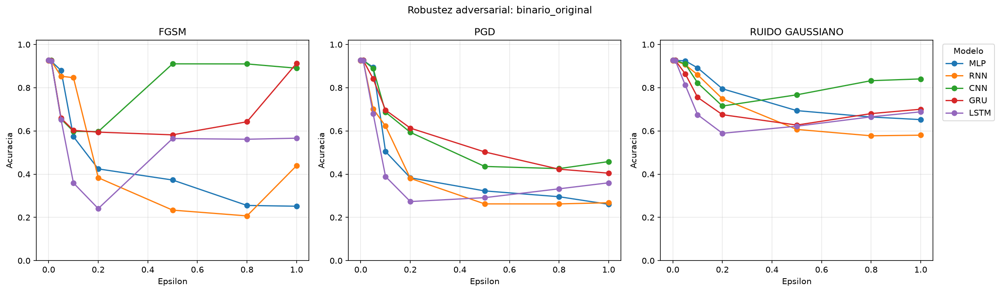
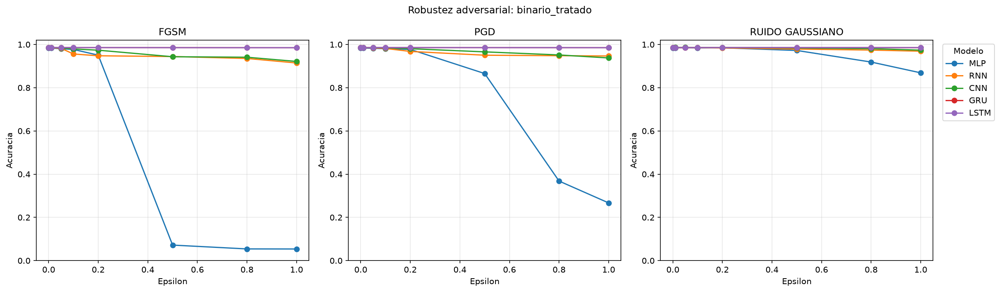
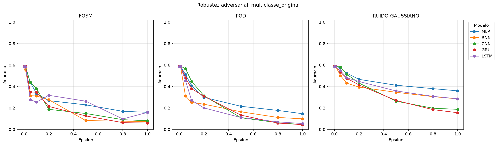
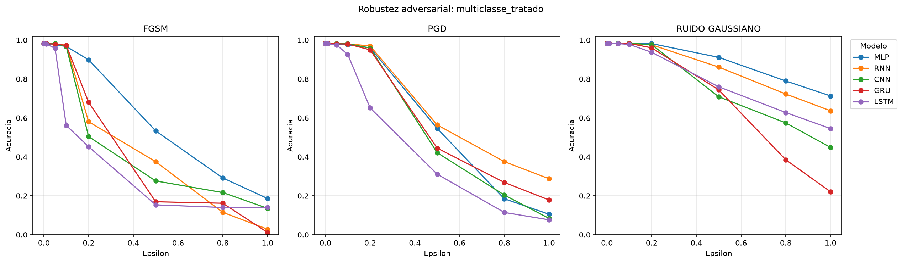
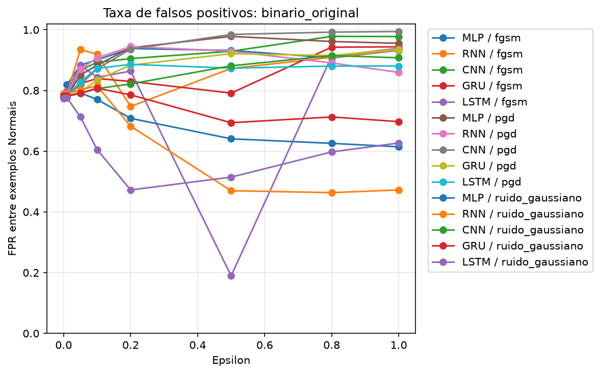
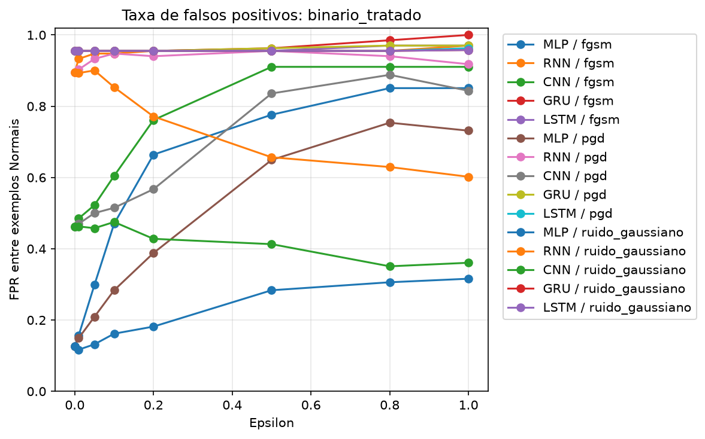

# Robustez de modelos de Deep Learning a ataques adversariais

[](https://www.python.org/)
[](https://pytorch.org/)
[](https://scikit-learn.org/)
[](https://www.icmc.usp.br/)

Este projeto avalia como perturbações adversariais afetam modelos de Deep Learning usados na classificação de tráfego de rede associado a ataques contra Veículos Aéreos Não Tripulados (VANTs / drones). São testados ataques baseados em gradiente e ruído aleatório em tarefas binária e multiclasse.

Este trabalho é a etapa de avaliação de robustez dos modelos apresentados em [`deep-learning-redes`](../deep-learning-redes/README.md): reutiliza os modelos, os scalers e as divisões de dados daquele projeto.

## Base de dados e modelos

O conjunto de dados de referência está disponível no [Figshare](https://figshare.com/articles/dataset/Unmanned_Aerial_Vehicles-Network_Intrusion_Detection_Dataset/25486462). A cópia `Normal+Attacks.csv` e os artefatos dos modelos estão no diretório `deep-learning-redes/`.

São avaliadas cinco arquiteturas — **MLP**, **RNN**, **CNN**, **GRU** e **LSTM** — em dois cenários:

- **Binário:** classificação entre `Normal` e `Ataque`.
- **Multiclasse:** identificação da classe do tráfego, incluindo `Reco+Scanning` como uma classe combinada.

O notebook compara os modelos de referência (`original`) com a classificação baseada em dados tratados. Essa versão deduplica os dados e, no caso multiclasse, agrupa `Reco` e `Scanning` e separa treino e teste por grupos de vetores de features. Mais detalhes sobre preparação dos dados, classes e limitações estão no README de [`deep-learning-redes`](../deep-learning-redes/README.md).

## Ataques e configuração

O notebook `ataques_adversariais.ipynb` aplica três tipos de perturbação:

- **FGSM** (*Fast Gradient Sign Method*): perturba os atributos na direção do gradiente da função de perda.
- **PGD** (*Projected Gradient Descent*): aplica atualizações iterativas e projeta as perturbações para dentro do limite definido por `epsilon`.
- **Ruído Gaussiano:** adiciona ruído aleatório, repetindo cada configuração três vezes para estimar a variação.

Os ataques por gradiente são não direcionados e usam o gradiente da perda do modelo. A configuração registrada usa seed `42`, batch size `256`, cinco iterações de PGD e os valores de `epsilon` `0.0`, `0.01`, `0.05`, `0.1`, `0.2`, `0.5`, `0.8` e `1.0`.

**Importante:** as entradas são padronizadas com `StandardScaler`; portanto, `epsilon` (e o desvio do ruído Gaussiano) está em unidades do espaço padronizado, não em unidades físicas dos atributos originais. Os resultados medem robustez sob essa configuração experimental e não equivalem a um ataque em uma rede operacional de VANTs.

## Resultados

A execução registrada está em `resultados_adversariais/`, que contém sempre os resultados atuais. Ao executar novamente o notebook, as métricas e figuras existentes são substituídas. Os resultados completos, por modelo, tarefa, cenário, ataque e intensidade, estão em [`metricas_ataques.csv`](resultados_adversariais/metricas_ataques.csv) e [`metricas_ataques.json`](resultados_adversariais/metricas_ataques.json). As tabelas e gráficos abaixo são reproduzidos desses arquivos.

### Exemplo binário: MLP com dados tratados

O exemplo abaixo acompanha o mesmo MLP e o mesmo conjunto de teste de 8.911 amostras. A linha limpa é a referência (`epsilon = 0`); para o ruído Gaussiano, as métricas são a média de três repetições.

| Perturbação | Acurácia limpa | F1 macro limpo | Acurácia com `epsilon = 0,05` | F1 macro com `epsilon = 0,05` | Acurácia com `epsilon = 1,0` | F1 macro com `epsilon = 1,0` |
| --- | ---: | ---: | ---: | ---: | ---: | ---: |
| FGSM | 98,43% | 80,88% | 98,02% | 75,32% | 5,38% | 5,15% |
| PGD | 98,43% | 80,88% | 98,20% | 78,04% | 26,70% | 21,43% |
| Ruído Gaussiano | 98,43% | 80,88% | 98,46% | 81,08% | 86,87% | 53,22% |

Neste caso, FGSM e PGD reduzem substancialmente as métricas em intensidades maiores. O ruído aleatório tem efeito diferente nesta execução, reforçando que as curvas dependem do tipo de perturbação e da intensidade. A comparação também mostra por que não basta reportar apenas acurácia: F1 macro ajuda a revelar o impacto sobre as classes menos representadas.

### Curvas e taxa de falsos positivos

As figuras comparam as duas tarefas e os dois conjuntos de modelos registrados:

| Tarefa | Modelos de referência (`original`) | Modelos com dados tratados |
| --- | --- | --- |
| Binária |  |  |
| Multiclasse |  |  |





Os cenários `original` e `tratado` usam modelos e preparações de dados diferentes. Compare a variação de cada curva em relação à sua própria linha limpa; não interprete diferenças entre esses cenários como um efeito isolado do ataque.

## Como reproduzir

O notebook depende do CSV, dos scalers e dos checkpoints gerados por `deep-learning-redes`. Ele localiza esses arquivos quando executado a partir da pasta `ataques-adversariais/`, da pasta `deep-learning-redes/` ou da raiz deste repositório. Os resultados ficam em `ataques-adversariais/resultados_adversariais/`, e os gráficos em `graficos/`.

Instale as dependências usadas pelo notebook em um ambiente Python com Jupyter:

```bash
pip install jupyter numpy pandas scikit-learn torch matplotlib seaborn joblib tqdm
```

Depois, abra `ataques_adversariais.ipynb` e execute as células em ordem. O processamento pode levar tempo, especialmente em CPU. Os resultados gerados substituem os arquivos atuais em `resultados_adversariais/`.

## Métricas e limitações

- As métricas incluem acurácia, F1 macro, especificidade, recall e precisão de ataque; para ruído Gaussiano também é registrada a variação entre repetições.
- O desbalanceamento entre classes afeta as métricas agregadas. Consulte os resultados por classe e o relatório do projeto de treinamento antes de tirar conclusões a partir da acurácia.
- Os valores de `epsilon` são relativos ao espaço padronizado e não têm, por si só, interpretação direta como intensidade de uma alteração em tráfego real.
- O ruído Gaussiano é repetido três vezes por configuração; essa quantidade limitada não caracteriza toda a variabilidade possível.
- Esta avaliação não inclui treinamento adversarial nem demonstra robustez em condições operacionais. Os resultados valem para os modelos, dados e parâmetros desta execução.

## Tecnologias

- **Linguagem:** Python 3
- **Deep Learning:** PyTorch
- **Dados e métricas:** NumPy, Pandas e scikit-learn
- **Visualização:** Matplotlib e Seaborn
- **Artefatos:** Joblib

## Autoria

Desenvolvido por **Luís Henrique Varela Medeiros Bezerra**  
Bacharelado em Ciência da Computação (BCC) — **ICMC / USP**  
GitHub: [@luishvarela](https://github.com/luishvarela)
