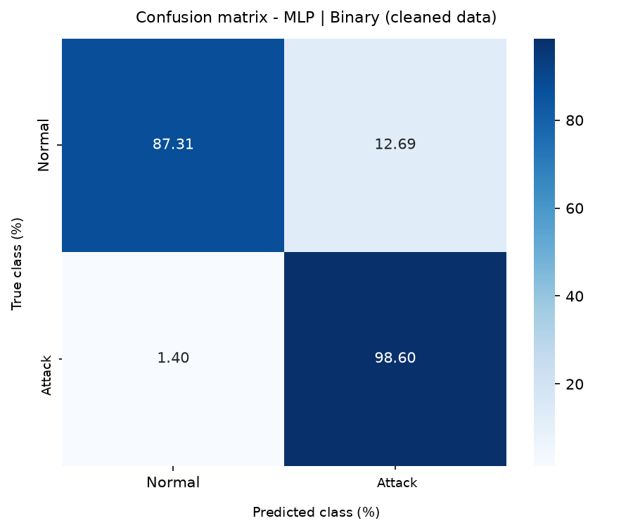
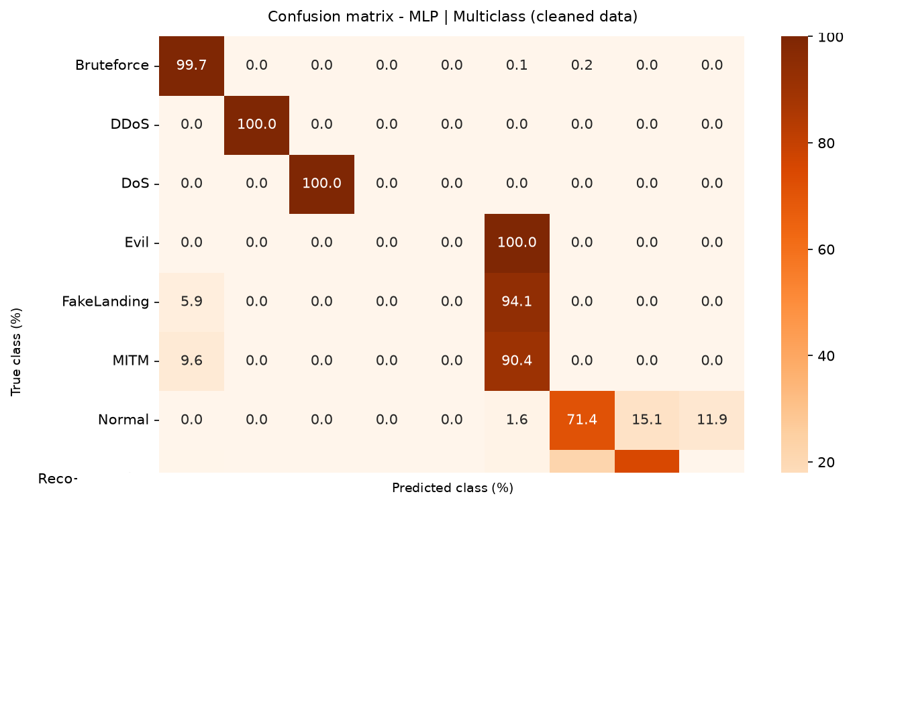

# Deep Learning Models for UAV Network Attack Detection

This project contains **deep learning** models for classifying network traffic associated with attacks against **Unmanned Aerial Vehicles (UAVs / drones)**. It compares neural architectures on two tasks: distinguishing normal traffic from attack traffic, then identifying the traffic class.

## Dataset and context

The reference dataset is available on [Figshare](https://figshare.com/articles/dataset/Unmanned_Aerial_Vehicles-Network_Intrusion_Detection_Dataset/25486462). The project uses the `Normal+Attacks.csv` copy. Each row represents a network flow described by statistical features, and the label column identifies its class.

The dataset contains nine attack labels and the `Normal` state. The experiments preserve the labels from the CSV: `Evil` corresponds to the Evil Twin scenario described by the source, while `Reply` is retained under the original file label.

| Attack | Technical description |
| --- | --- |
| **`Bruteforce`** | A brute-force attack against the drone's management interface or credentials to gain unauthorized access. |
| **`DDoS`** | A distributed denial-of-service attack that overloads the communication link or onboard services. |
| **`DoS`** | A denial-of-service attack that exhausts processing resources or disrupts the drone's connection. |
| **`Evil`** | Label associated with the Evil Twin scenario: cloning an access point or ground control station (GCS) to induce a connection to a fake network. |
| **`FakeLanding`** | Sending spoofed packets or telemetry to induce a forced or incorrect landing at an unintended location. |
| **`MITM`** | *Man-in-the-Middle*: intercepting and potentially modifying messages exchanged between the drone and its ground control station. |
| **`Reco`** | Reconnaissance and passive or active information gathering about the drone and its network infrastructure. |
| **`Reply`** | CSV label retained as-is in the experiments and reports. |
| **`Scanning`** | Active scanning for open ports and services on communication modules or onboard systems. |
| **`Normal`** | The standard operating state, representing legitimate traffic, secure telemetry, and expected flight commands. |

## Methodology and project layout

- Data is loaded and prepared with *Pandas* and *NumPy*. Models are implemented in *PyTorch* and evaluated with *scikit-learn* metrics.
- Each task has a reference run and a cleaned-data version. The binary version removes duplicates and a constant column; the multiclass version also combines `Reco` and `Scanning` because they have repeated feature vectors in the dataset used.
- Five architectures are compared: **MLP**, **RNN**, **CNN**, **GRU**, and **LSTM**. Preprocessing standardizes features with `StandardScaler`, fitted on the training data.
- Hyperparameter tuning is performed separately for each task with Optuna in `binary_tuning.ipynb` and `multiclass_tuning.ipynb`. The training and evaluation workflows are in `binary_training.ipynb` and `multiclass_training.ipynb`.

The `treated_binary_classification/` and `treated_multiclass_classification/` directories contain the current cleaned-data results: metrics, preprocessing summaries, and models with their scalers. Rerunning the training notebooks replaces these files; it does not create timestamped directories or retain previous runs. `trained_models/` stores the reference-run models, `../graphics/` contains the project's figures, and `bayesian_tuning/` contains the best hyperparameters found.

## Results and comparisons

The tables below summarize the current results saved in `treated_binary_classification/` and `treated_multiclass_classification/` (2026-10-28).

### Binary classification

The cleaned binary classification removes the constant `fwd_seg_size_min` column and duplicate rows, reducing the dataset from 149,434 to 35,637 rows. The test set contains 8,911 examples: 134 `Normal` and 8,777 `Attack`. The decision threshold is 0.5.

| Model | Accuracy | Macro F1 | Specificity (Normal) | Attack recall |
| --- | ---: | ---: | ---: | ---: |
| MLP | 98.43% | **80.88%** | **87.31%** | 98.60% |
| RNN | 98.56% | 58.61% | 10.45% | 99.91% |
| CNN | **98.77%** | 67.71% | 23.13% | 99.92% |
| GRU | 98.56% | 53.92% | 4.48% | **100.00%** |
| LSTM | 98.56% | 53.92% | 4.48% | **100.00%** |

The CNN achieved the highest accuracy, while the MLP achieved the best macro F1 and highest specificity. Since only 1.5% of the test set is `Normal`, accuracy alone favors models that classify almost everything as an attack. In particular, the GRU and LSTM detected every attack but incorrectly classified more than 95% of normal examples as attacks.

*MLP confusion matrix on the binary test set. The MLP has the highest specificity in this version.*

### Multiclass classification

In the cleaned multiclass task, `Reco` and `Scanning` are combined into `Reco+Scanning`. After removing duplicates and the constant column, 35,654 rows remain. The split uses the first fold of a four-fold `StratifiedGroupKFold`, grouping feature vectors. The summary records zero groups shared between training and test. Therefore, these results represent **one fold**, not the average of all four folds.

| Model | Accuracy | Macro F1 |
| --- | ---: | ---: |
| MLP | 98.26% | **64.41%** |
| RNN | 98.17% | 61.02% |
| CNN | 98.28% | 61.90% |
| GRU | **98.31%** | 60.88% |
| LSTM | 98.17% | 62.33% |

The GRU achieved the highest accuracy, while the MLP achieved the highest macro F1. In the test set, `DDoS` and `DoS` account for 7,104 of the 8,914 examples. `Evil` has only two examples and `FakeLanding` has 17. For the MLP, the F1 score was 0.00% for both; the F1 scores were 60.00% for `Normal`, 73.44% for `MITM`, 82.82% for `Reco+Scanning`, and 63.92% for `Reply`. Thus, high overall accuracy does not imply uniform performance across classes.

*MLP confusion matrix on the grouped multiclass fold. The MLP achieved the highest macro F1 among the evaluated architectures.*

### Hyperparameter tuning

The following values are the best validation accuracies found during tuning, **not** test-set metrics. The notebooks are configured for 25 trials, up to 25 epochs per trial, and select hyperparameters based on `val_accuracy`.

| Model | Binary validation accuracy | Multiclass validation accuracy |
| --- | ---: | ---: |
| MLP | 92.94% | 58.82% |
| CNN | **92.97%** | **59.11%** |
| RNN | 92.88% | 58.79% |
| GRU | 92.96% | 59.05% |
| LSTM | 92.87% | 58.79% |

The complete parameters are in `bayesian_tuning/`, alongside `best_hyperparameters_summary_binary.json` and `best_hyperparameters_summary_multiclass.json`.

### Adversarial training

The binary and multiclass adversarial-training pilots are in [`adversarial-attacks/`](../adversarial-attacks/README.md): [`adversarial_training_binary.ipynb`](../adversarial-attacks/adversarial_training_binary.ipynb) and [`adversarial_training_multiclass.ipynb`](../adversarial-attacks/adversarial_training_multiclass.ipynb). They reuse the checkpoints, scalers, encoder, and hyperparameters generated here; the `AdvTrain` results and checkpoints are stored in dedicated subdirectories under `adversarial-attacks/adversarial_results/`.

### Comparison with the reference paper

Hadi et al., in [“UAV-NIDD: A Dynamic Dataset for Cybersecurity and Intrusion Detection in UAV Networks”](https://doi.org/10.1109/TNSE.2025.3553442), present model evaluations for the UAV (Case 1), access point (AP, Case 2), and ground control station (GCS, Case 3) scenarios. The conclusion reports the following FNN accuracies:

| Paper scenario | FNN accuracy |
| --- | ---: |
| UAV (Case 1) | 97.28% |
| Access point (AP, Case 2) | 98.69% |
| Ground control station (GCS, Case 3) | 99.02% |

For the UAV scenario, the results section reports 97.18%, while the conclusion reports 97.28%; the table reproduces the conclusion's value.

In this project, the highest binary accuracy is 98.77% (CNN) and the highest multiclass accuracy is 98.31% (GRU). These values provide context, **not a direct comparison**: the paper separates communication scenarios and evaluates FNN, MLP, and MAML under its own conditions, whereas this project compares MLP, RNN, CNN, GRU, and LSTM on binary and multiclass tasks. The split protocols, features, and metrics must also be equivalent before concluding that one method outperforms another. The paper describes a random grid search for its models, while this project uses Optuna with TPE.

**Reference:** H. J. Hadi, Y. Cao, M. K. Khan, N. Ahmad, Y. Hu, and C. Fu, “UAV-NIDD: A Dynamic Dataset for Cybersecurity and Intrusion Detection in UAV Networks,” *IEEE Transactions on Network Science and Engineering*, 2025. [https://doi.org/10.1109/TNSE.2025.3553442](https://doi.org/10.1109/TNSE.2025.3553442).

### Interpretation and limitations

- The classes are highly imbalanced. Macro F1, per-class recall, and specificity are therefore more informative than accuracy alone.
- The binary test set contains only 134 normal examples. The estimated specificity may vary substantially with a different data split.
- The multiclass results documented here correspond to a single fold. Results aggregated over all four folds, confidence intervals, and comparisons across multiple seeds are not yet available.
- After cleaning, the summaries still record feature vectors associated with conflicting labels (15 in binary and 23 in multiclass). This data property should be investigated before drawing conclusions about generalization.
- The reference run and cleaned-data results use different protocols and test-set counts; they should not be combined as if they were the same evaluation. Images containing `original` in `../graphics/` belong to the reference run; images containing `*_cleaned_*` belong to the cleaned-data classification.
- These are experimental results on a specific dataset. They do not, by themselves, demonstrate operational effectiveness on production UAV traffic.

### Reproduction

1. Open the notebook for the task you need (`binary_training.ipynb` or `multiclass_training.ipynb`) in a Jupyter environment with the dependencies listed below.
2. Run its cells in order and make sure `Normal+Attacks.csv` is in the same directory as the notebooks.
3. To redo hyperparameter tuning, run the corresponding `tuning_*.ipynb` notebook. Tuning writes results to `bayesian_tuning/` and can take time because it runs multiple trials per architecture.

The `training_metrics.json` and `training_summary.json` files in each `treated_*_classification/` directory are the source of truth for the metrics reported above. These directories also contain the current model weights, scalers, and confusion matrices.

## Technologies and libraries

- **Language:** `Python 3`
- **Data handling:** `pandas`, `numpy`
- **Visualization:** `matplotlib`, `seaborn`
- **Deep learning and validation:** `scikit-learn`, `PyTorch`, `Optuna`

## Author

Developed by **Luís Henrique Varela Medeiros Bezerra**

Bachelor's degree in Computer Science — **ICMC / USP**

GitHub: [@luishvarela](https://github.com/luishvarela)
