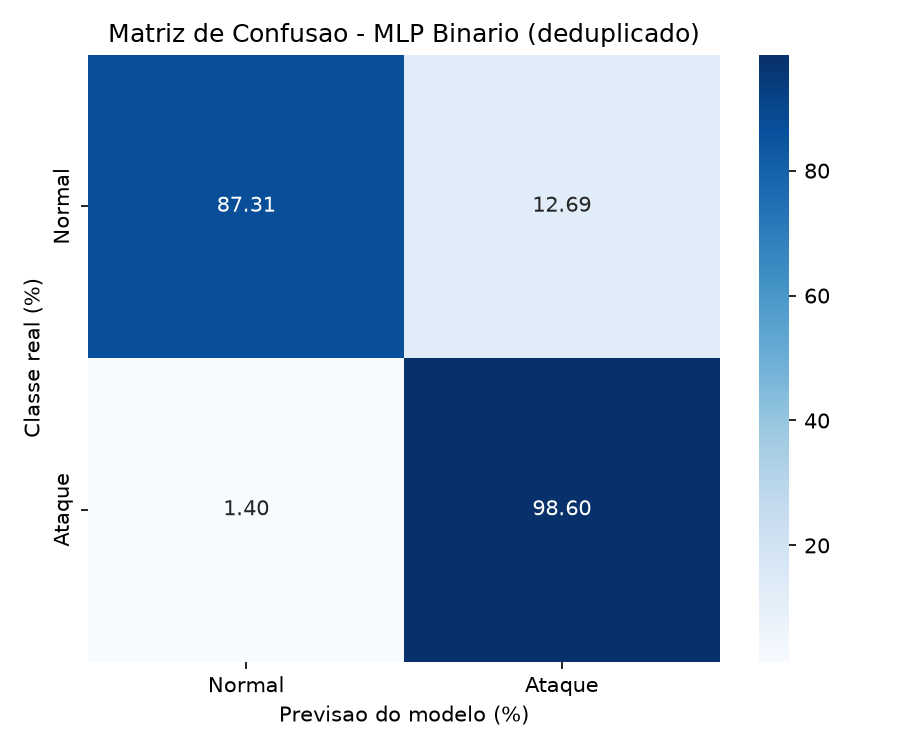
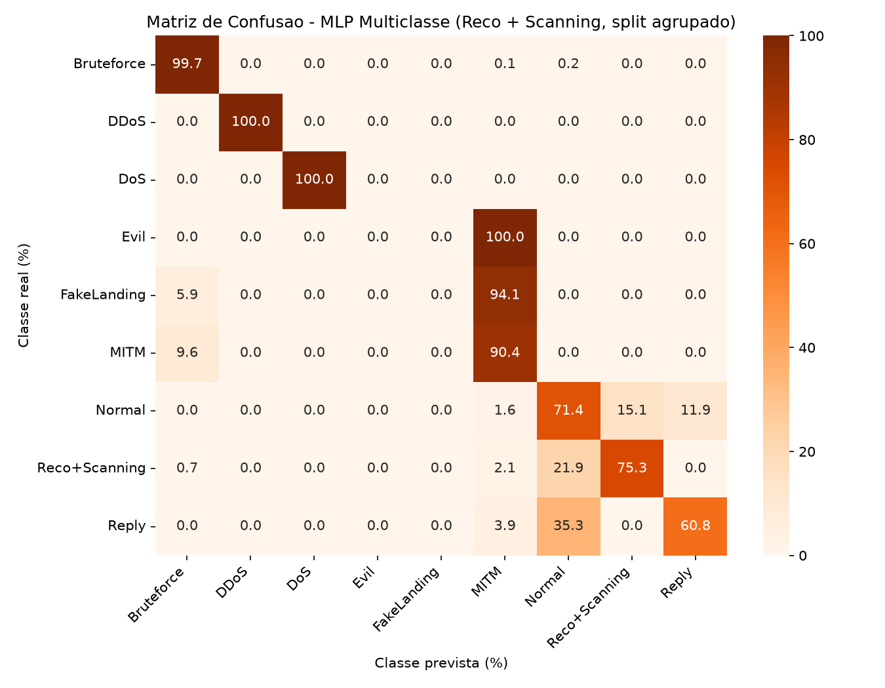

# Avaliação de modelos de Deep Learning na detecção de ataques de rede em VANTs

Este diretório reúne modelos de **Deep Learning** para classificar tráfego de rede associado a ataques contra **Veículos Aéreos Não Tripulados (VANTs / drones)**. O trabalho compara arquiteturas neurais em dois problemas: distinguir tráfego normal de tráfego de ataque e, em seguida, identificar a classe do tráfego.

--- 
## Contexto & Base de Dados

O conjunto de dados de referência está disponível no [Figshare](https://figshare.com/articles/dataset/Unmanned_Aerial_Vehicles-Network_Intrusion_Detection_Dataset/25486462). A cópia usada no projeto está em `Normal+Attacks.csv`; as linhas representam fluxos de rede descritos por atributos estatísticos, e a coluna de rótulo indica a classe do fluxo.

O dataset contém nove rótulos de ataque e o estado `Normal`. Os nomes abaixo refletem os rótulos usados na documentação e nos artefatos do projeto. Nos resultados salvos aparecem `Evil` e `Reply`; mantive esses nomes para corresponder aos dados, embora a descrição de `Evil` seja apresentada como Evil Twin e `Reply` possa exigir confirmação de nomenclatura na fonte original.

| Ataque | Descrição Técnica |
| --- | --- | --- |
| **`Bruteforce`** | Ataque de força bruta contra a interface de gerenciamento ou credenciais do drone para obter acesso não autorizado. |
| **`DDoS`** | Ataque de Negação de Serviço Distribuída para sobrecarregar o link de comunicação ou os serviços embarcados do drone. |
| **`DoS`** | Ataque de Negação de Serviço convencional para esgotar os recursos de processamento ou derrubar a conexão do drone. |
| **`Evil`** | Rótulo associado ao cenário Evil Twin: clonagem de um ponto de acesso ou da estação de controle em solo (GCS) para induzir a conexão a uma rede falsa. |
| **`FakeLanding`** | Envio de pacotes ou dados de telemetria falsificados para induzir o drone a realizar um pouso forçado ou incorreto em local não planejado. |
| **`MITM`** | *Man-in-the-Middle*: Interceptação e potencial alteração das mensagens trocadas entre o drone e a estação de controle em solo. |
| **`Reco`** | Fase de reconhecimento e coleta de informações passivas ou ativas sobre o drone e sua infraestrutura de rede. |
| **`Reply`** | Rótulo presente no CSV e nos relatórios salvos. A relação entre esse nome e o ataque *Replay* deve ser confirmada na documentação da fonte antes de normalizar o rótulo. |
| **`Scanning`** | Varredura ativa de portas e serviços abertos nos módulos de comunicação ou sistemas embarcados do drone. |
| **`Normal`** | Estado de operação padrão, representando o tráfego legítimo, telemetria segura e comandos de voo esperados. |

## Metodologia & Layout do projeto

- Os dados são carregados e preparados com *Pandas* e *NumPy*. Os modelos são implementados em *PyTorch* e avaliados com métricas do *scikit-learn*.

- Cada tarefa tem uma execução de referência e uma versão com os dados tratados: a versão binária remove duplicatas e uma coluna constante; a multiclasse também combina `Reco` com `Scanning`, pois essas classes têm atributos repetidos no conjunto utilizado.

- Foram comparadas cinco arquiteturas: **MLP**, **RNN**, **CNN**, **GRU** e **LSTM**. O pré-processamento inclui a padronização das features com `StandardScaler`; nos notebooks, o scaler é ajustado usando os dados de treino.

- O tuning de hiperparâmetros é feito separadamente por tarefa com Optuna, nos notebooks `tuning_binario.ipynb` e `tuning_multiclasse.ipynb`. Os notebooks `treinamento_binario.ipynb` e `treinamento_multiclasse.ipynb` contêm os fluxos de treinamento e avaliação.

Os diretórios `classificacao_binaria_tratada/` e `classificacao_multiclasse_tratada/` contêm os resultados atuais das versões com dados tratados: métricas, resumo da preparação e modelos com seus scalers. Ao executar novamente os notebooks de treinamento, esses arquivos são substituídos; não são criadas pastas com timestamps nem mantidas cópias de execuções anteriores. `modelos_treinados/` guarda os modelos da execução de referência, `../graficos/` reúne todas as imagens do projeto, e `tuning_bayesiano/` contém os melhores hiperparâmetros encontrados.

---

## Resultados & Comparações

As tabelas abaixo resumem os resultados atuais salvos em `classificacao_binaria_tratada/` e `classificacao_multiclasse_tratada/` (28/10/26).

### Classificação binária

A classificação binária com dados tratados removeu a coluna constante `fwd_seg_size_min` e duplicatas, reduzindo o dataset de 149.434 para 35.637 linhas. O conjunto de teste tem 8.911 exemplos: 134 `Normal` e 8.777 `Ataque`. O limiar de decisão usado foi 0,5.

| Modelo | Acurácia | F1 macro | Especificidade (Normal) | Recall de Ataque |
| --- | ---: | ---: | ---: | ---: |
| MLP | 98,43% | **80,88%** | **87,31%** | 98,60% |
| RNN | 98,56% | 58,61% | 10,45% | 99,91% |
| CNN | **98,77%** | 67,71% | 23,13% | 99,92% |
| GRU | 98,56% | 53,92% | 4,48% | **100,00%** |
| LSTM | 98,56% | 53,92% | 4,48% | **100,00%** |

A CNN obteve a maior acurácia, mas o MLP teve o melhor F1 macro e a maior especificidade. Como apenas 1,5% do teste é `Normal`, a acurácia isolada favorece modelos que classificam quase tudo como ataque. Em particular, GRU e LSTM detectaram todos os ataques, mas classificaram incorretamente como ataque mais de 95% dos exemplos normais.

*Matriz de confusão do MLP no teste binário. O MLP é o modelo com maior especificidade nesta versão.*

### Classificação multiclasse

Na classificação multiclasse com dados tratados, `Reco` e `Scanning` foram unidas em `Reco+Scanning`; após a remoção de duplicatas e da coluna constante, restaram 35.654 linhas. A divisão foi feita com o primeiro fold de um `StratifiedGroupKFold` de quatro folds, agrupando vetores de features. O resumo registra zero grupos compartilhados entre treino e teste. Os resultados, portanto, representam **um fold**, não a média dos quatro folds.

| Modelo | Acurácia | F1 macro |
| --- | ---: | ---: |
| MLP | 98,26% | **64,41%** |
| RNN | 98,17% | 61,02% |
| CNN | 98,28% | 61,90% |
| GRU | **98,31%** | 60,88% |
| LSTM | 98,17% | 62,33% |

O GRU obteve a maior acurácia, enquanto o MLP apresentou o maior F1 macro. No teste, `DDoS` e `DoS` somam 7.104 dos 8.914 exemplos. Já `Evil` tem apenas dois exemplos e `FakeLanding`, 17. Para o MLP, o F1 foi 0,00% em ambas; o F1 de `Normal` foi 60,00%, de `MITM` 73,44%, de `Reco+Scanning` 82,82% e de `Reply` 63,92%. A acurácia global alta, portanto, não significa desempenho uniforme entre as classes.

*Matriz de confusão do MLP no fold multiclasse agrupado. O MLP teve o maior F1 macro entre as arquiteturas avaliadas.*

### Tuning de hiperparâmetros

Os valores a seguir são a melhor acurácia de validação encontrada no tuning, **não** métricas do conjunto de teste. Os notebooks configuram 25 tentativas, até 25 épocas por tentativa, e selecionam os hiperparâmetros pela `val_accuracy`.

| Modelo | Val. accuracy binário | Val. accuracy multiclasse |
| --- | ---: | ---: |
| MLP | 92,94% | 58,82% |
| CNN | **92,97%** | **59,11%** |
| RNN | 92,88% | 58,79% |
| GRU | 92,96% | 59,05% |
| LSTM | 92,87% | 58,79% |

Os parâmetros completos estão em `tuning_bayesiano/`, junto aos resumos `resumo_melhores_hp_binario.json` e `resumo_melhores_hp_multiclasse.json`.

### Interpretação e limitações

- As classes são fortemente desbalanceadas. Por isso, F1 macro, recall por classe e especificidade são mais informativos que acurácia isolada.
- O teste binário contém somente 134 exemplos normais. A especificidade estimada pode variar bastante com outra divisão dos dados.
- A avaliação multiclasse documentada aqui corresponde a um único fold. Ainda não há resultados agregados dos quatro folds, intervalos de confiança ou comparação entre múltiplas seeds.
- Após a limpeza, os resumos ainda registram vetores de features associados a rótulos conflitantes (15 no binário e 23 no multiclasse). Isso é uma característica dos dados que merece investigação antes de conclusões sobre generalização.
- As métricas da execução de referência e da versão com dados tratados usam protocolos e contagens de teste diferentes; não devem ser combinadas como se fossem a mesma avaliação. As imagens com o trecho `original` em `../graficos/` pertencem à execução de referência; as imagens `*_tratada_*` pertencem à classificação com dados tratados.
- Estes resultados são experimentais e medem classificação sobre um dataset específico. Não demonstram, por si só, eficácia operacional em tráfego de VANTs em produção.

### Como reproduzir

1. Abra o notebook da tarefa desejada (`treinamento_binario.ipynb` ou `treinamento_multiclasse.ipynb`) em um ambiente Jupyter com as dependências listadas abaixo.
2. Execute as células em ordem, verificando se `Normal+Attacks.csv` está no mesmo diretório dos notebooks.
3. Para refazer o tuning, execute o notebook `tuning_*.ipynb` correspondente. O tuning salva resultados em `tuning_bayesiano/` e pode demandar tempo de processamento, pois executa vários trials por arquitetura.

Os arquivos `metricas_treinamento.json` e `resumo_treinamento.json` em cada diretório `classificacao_*_tratada/` são a referência para as métricas publicadas acima; esses diretórios também guardam os pesos, scalers e matrizes de confusão dos modelos atuais.

---

## Tecnologias & Bibliotecas

- **Linguagem:** `Python 3`
- **Manipulação de Dados:** `pandas`, `numpy`
- **Visualização de Dados:** `matplotlib`, `seaborn`
- **Deep Learning & Validação:** `scikit-learn`, `PyTorch`, `Optuna`

---

## Autor

Desenvolvido por **Luís Henrique Varela Medeiros Bezerra**  
* Bacharelado em Ciência de Computação (BCC) — **ICMC / USP**  
* GitHub: [@luishvarela](https://github.com/luishvarela)
